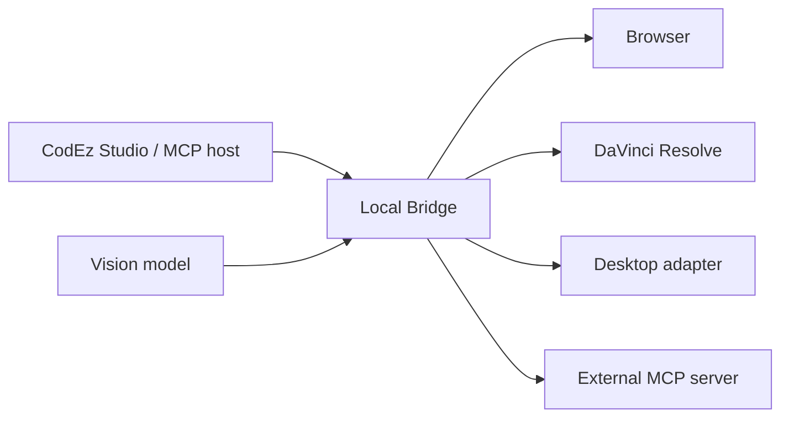

<div align="center">

# CodEz Studio Bridge

**Local tools. Controlled actions. One MCP connection.**

Browser automation, video editing and vision-guided desktop interaction for CodEz Studio and compatible MCP hosts.

[](#release-gate-020)
[](pyproject.toml)
[](LICENSE)
[](#release-gate-020)

[Установка](#установка) · [MCP](#подключение-к-mcp-host) · [Browser](#браузер) · [Vision](#рабочий-стол-и-vision) · [Resolve](#davinci-resolve) · [Проверки](#проверки)

</div>

---

> **Отдельный локальный модуль**, не исходники Rust IDE и не замена CLI CodEz. Все серверы отключены по умолчанию. Новая лицензия допускает публичный просмотр исходников; использование требует разрешения правообладателя с учётом ранее предоставленных прав и применимого законодательства.

## Capabilities

| Subsystem | Interface | Verification |
| :--- | :--- | :--- |
| Browser | 19 tools · Playwright | Real Chromium DOM test |
| DaVinci Resolve | 26 tools · Scripting API | Contract fixtures; live Resolve unverified |
| Desktop | 9 tools · X11 / Win32 / Wayland | Live X11; Windows and Wayland pending |
| MCP | Tools, resources, prompts | Stdio and Streamable HTTP tests |
| OAuth | Registered clients · PKCE | Local authorization/refresh fixtures |
| Vision | Chat Completions · image input | Test model endpoint + real X11 window |



Permissions are local, server-scoped and deny by default. Screen sharing is explicit; emergency stop terminates local work without promising rollback of already executed actions.

## Source layout

| Directory | Responsibility |
| :--- | :--- |
| [studio_bridge](studio_bridge) | MCP transport, policy, OAuth, browser, desktop, Resolve and Vision |
| [examples](examples) | Example configurations and tool catalog |
| [tests](tests) | Protocol, adapter, permission and integration tests |
| [scripts](scripts) | Package build and smoke checks |

## Установка

Debian/Ubuntu с Python 3.11+: `sudo apt install ./codez-studio-bridge_0.2.0-1_all.deb`.
Portable: `python3 codez-studio-bridge.pyz --version`. Вместо `codez-studio-bridge` можно использовать `python3 /absolute/path/codez-studio-bridge.pyz`.

```sh
codez-studio-bridge init --config "$HOME/.config/codez/bridge.json" --workspace "$PWD"
codez-studio-bridge doctor --config "$HOME/.config/codez/bridge.json"
codez-studio-bridge tools --config "$HOME/.config/codez/bridge.json"
```

Для браузера установите в тот же Python официальные зависимости [Playwright](https://playwright.dev/python/docs/intro) и Pillow; для X11 также python-xlib. Для Playwright потребуется установленный браузер. Используйте виртуальное окружение и его интерпретатор с `.pyz`, если системный Python защищён от pip. Пакет не скачивает SDK и не содержит сторонних библиотек.

## Подключение к MCP host

Команда: `codez-studio-bridge serve --config /absolute/path/bridge.json`. Пример настройки host: `examples/mcp-host.example.json`; формат зависит от host. Это интерфейс интеграции, а не подтверждение поддержки MCP текущей сборкой CodEz.

`examples/config.example.json` - исходная конфигурация. В `servers` включите только нужный сервер (`enabled: true`), заполните `allow_tools` именами из `examples/tool-catalog.json`. `read_tools` - подмножество разрешённых инструментов. `mode: read-only` блокирует изменения; `mode: approved` заранее разрешает перечисленные операции. Не импортируйте неизвестные конфигурации и команды. Для дополнительных MCP используйте `transport: stdio` с явными `command` и `args` либо `transport: http` с HTTPS URL (HTTP только loopback), опционально `token_env` с именем переменной. `env` содержит имена дополнительно передаваемых переменных среды, не секретные значения.

Поддерживаются MCP initialize, ping, tools/list, tools/call, resources/list, resources/read, prompts/list и prompts/get по stdio и Streamable HTTP JSON/SSE ответы. Версии протокола: 2024-11-05, 2025-03-26, 2025-06-18, 2025-11-25. Ресурсы и prompts включаются только точными списками `allow_resources` (URI) и `allow_prompts` (имена) на каждом сервере. Каталоги ограничены 2 МиБ и 16 страницами. URI ресурсов заменяются стабильными локальными идентификаторами; prompt names получают префикс сервера. Внешние инструкции и содержимое являются недоверенными данными. Шаблоны URI, подписки на ресурсы, sampling, elicitation и самостоятельный GET SSE stream не поддерживаются. `bridge_status` показывает соединения; `bridge_stop` прерывает локальный вызов, закрывает дочерние процессы и блокирует новые вызовы до перезапуска. Уже выполненные действия не откатываются; результат прерванного удалённого вызова может быть неизвестен.

## MCP OAuth (зарегистрированный публичный клиент)

Для HTTP-сервера настройте `oauth.issuer`, `oauth.client_id`, `oauth.scopes` и при необходимости `oauth.redirect_port` (зарегистрированный loopback callback `/callback`). Пример `examples/oauth-http.server.json` содержит намеренно нерабочие адреса `example.invalid`, которые нужно заменить действительными. Не используйте одновременно `token_env` и `oauth`. Сервер должен быть явно включён.

```sh
codez-studio-bridge auth login myserver --config "$HOME/.config/codez/bridge.json"
codez-studio-bridge auth status myserver --config "$HOME/.config/codez/bridge.json"
codez-studio-bridge auth refresh myserver --config "$HOME/.config/codez/bridge.json"
codez-studio-bridge auth logout myserver --config "$HOME/.config/codez/bridge.json"
```

Используется discovery RFC 9728 через Bearer challenge или well-known URL, проверка настроенного issuer, OAuth metadata, S256 PKCE, одноразовый state, локальный callback на 127.0.0.1 и resource binding. Секреты не печатаются. Scope escalation не выполняется автоматически. Access/refresh токены сохраняются на POSIX в приватном каталоге рядом с конфигурацией (без шифрования), с блокировкой одновременных операций. `logout` удаляет локальный кеш, но не отзывает токен на сервере. Истёкший токен требует явного refresh/login и нового MCP-сеанса. Токены с неизвестным временем жизни отклоняются. Dynamic Client Registration не реализован; Windows использует ранее существовавший `token_env`. Поддержка конкретного identity provider требует интеграционной проверки. Никакая ошибочная мутация не повторяется автоматически.

## Браузер

Встроенный адаптер использует Python Playwright. В `browser.origins` укажите точные разрешённые origin (схема, хост и порт), например `http://localhost:3000` для своего проекта. `engine`: chromium, firefox или webkit; необходим соответствующий установленный браузер. `headless: false` открывает видимое окно, `sandbox: true` рекомендуется оставлять включённым. Контекст отдельный, без профиля пользователя. Загрузку локальных файлов разрешает `allow_uploads: true`; файл должен находиться в workspace. Для скачивания задайте существующий `downloads_dir` внутри workspace. `allow_websockets` отключён по умолчанию.

Для официального Microsoft Playwright MCP есть `examples/playwright-mcp.server.json`. Установите совместимый релиз по инструкции [репозитория](https://github.com/microsoft/playwright-mcp), проверьте путь команды, инструменты и правила доступа перед включением. Внешний сервер выполняется со своими правами и не наследует встроенную фильтрацию origin. Встроенный фильтр тоже не является сетевой песочницей ОС.

## Рабочий стол и Vision

Linux X11/XTEST + Pillow; Win32/GDI/SendInput на Windows 10/11. Wayland: добавлен XDG ScreenCast/RemoteDesktop + PipeWire; проверен контракт адаптера, не реальный композитор. macOS не реализована. На X11 нужен TrueColor и доступ к выбранному дисплею. Используйте `desktop__windows` для списка окон, затем укажите точный `desktop.window_id`, при необходимости `title_contains`. Изменение требует перезапуска моста. Скриншоты и координатные операции ограничены выбранным активным окном; кадр одноразовый, устаревшие кадры отклоняются. Это не песочница ОС. Не используйте на окнах с секретными данными. X11-ввод текста ограничен ASCII и текущей раскладкой, Win32 использует Unicode.

Заполните `vision.model` действительным ID vision-модели, `base_url` совместимым Chat Completions endpoint, передайте ключ через `CODEZ_VISION_API_KEY`. `output_token_field` поддерживает `max_completion_tokens` и `max_tokens`. Включите desktop и разрешите необходимые инструменты. Для действий нужен `mode: approved`.

```sh
codez-studio-bridge vision --config "$HOME/.config/codez/bridge.json" \
  --task 'Проверь интерфейс выбранного тестового приложения' --allow-screen --steps 8
```

`--allow-screen` - явное согласие на отправку снимков выбранного окна или явно выбранного через портал монитора провайдеру в рамках запуска. Действия требуют подтверждения в терминале, если не передан `--approve-actions` (только уже разрешённые операции). Не включайте preapproval для чувствительных приложений. Ctrl+C останавливает локальную сессию. Ответ `model_reported_done` означает заявление модели о завершении, а не независимое доказательство результата. Нужен провайдер с совместимым форматом изображений и JSON-ответов.

## Wayland

Системные зависимости: PyGObject (GI), GStreamer 1.x, PipeWire (`pipewiresrc`), JPEG encoder, Pillow и работающий backend XDG Desktop Portal с нужным интерфейсом. Установка зависит от дистрибутива. Настройте `desktop.portal_scope` как `window` или `monitor`; на Wayland окно/монитор выбирается через системный диалог, не по `window_id`. Для интерактивного согласия увеличьте `servers.desktop.timeout` до 150-180 секунд.

- По умолчанию доступны только снимки (если `screenshot` разрешён).
- Для управления мышью установите `portal_scope: "monitor"`, `allow_portal_input: true`, `mode: "approved"` и явно разрешите соответствующие инструменты.
- Для клавиатуры отдельно включите `allow_global_keyboard: true`. Клавиатурные события направляются в текущий фокус композитора, а не в изолированное окно. Vision требует подтверждения каждого действия при включённой глобальной клавиатуре.
- Никакие постоянные portal grants и restore tokens не сохраняются. На закрытие сеанса или изменение размеров видеопотока требуется повторный запуск и новое согласие.

Используются совместимые NotifyPointer/NotifyKeyboard методы RemoteDesktop portal; композиторы, требующие только ConnectToEIS, пока не поддерживаются. Реальная проверка на Wayland обязательна перед публичным релизом.

## DaVinci Resolve

Откройте установленный Resolve и настройте разрешённый внешний scripting API согласно документации вашей версии/редакции. Укажите фактические пути к `DaVinciResolveScript.py` (каталог `resolve.module_dir`) и библиотеке `resolve.script_library`, если необходима. Например, в некоторых Linux-установках используются `/opt/resolve/Developer/Scripting/Modules` и `/opt/resolve/libs/Fusion/fusionscript.so`. Укажите точное `project_name` и по возможности `project_id`. Для создания проекта явно включите `allow_create_project`. Для рендера задайте существующий `render_dir` внутри workspace. Мост управляет только заданиями, созданными в текущей сессии. Поддерживаются проекты, media pool, timeline, markers, render presets и очередь рендера, дорожки (создание, имя, enabled/locked), playhead, генерация субтитров встроенной функцией Resolve и вставка установленного Fusion Title. Доступность методов зависит от версии Resolve. Для нативного или стороннего MCP заполните `examples/resolve-native-mcp.server.json` реальным endpoint.

## Проверки

```sh
python3 -m unittest discover -s tests -v
CODEZ_X11_TEST=1 xvfb-run -a -s '-screen 0 1024x768x24' python3 -m unittest discover -s tests -v
bash scripts/build.sh
```

Тесты используют временные каталоги, локальный HTTP fixture модели и отдельный X11 дисплей. Live browser navigation требует `CODEZ_LIVE_BROWSER_TEST=1`; в среде сборки запрещена административной политикой Chromium. Офлайн тест реального Chromium проверяет DOM, действия и скриншоты. API Resolve и Wayland проверены с тестовыми объектами; реальный Resolve, Wayland, Windows и внешний Vision API не проверены. Оригинальные Rust-исходники Studio отсутствовали, поэтому GUI не изменён. `call --approve` выполняет один вызов в новой сессии; для последовательности действий используйте `serve` или `vision`.

## Release gate 0.2.0

Для интерактивной Windows проверки: `set CODEZ_WINDOWS_TEST=1` в cmd и `python -m unittest discover -s tests -p test_windows_live.py -v`. Запускать только в изолированном интерактивном сеансе с Tkinter/Pillow. Для Resolve сначала проверьте установленную версию и отдельный тестовый проект; изменения на рабочих проектах не используются как smoke tests. Для Wayland запустите `serve`, откройте только тестовый экран и явно подтвердите запрос портала.

Не считать эту сборку production-ready на всех платформах: нативный GUI исходного CodEz Studio недоступен, live тесты Windows, Wayland, Resolve и внешнего AI не выполнены. Browser origin routing не является полноценной сетевой песочницей; для строгой изоляции необходимы отдельные системные egress-политики.
