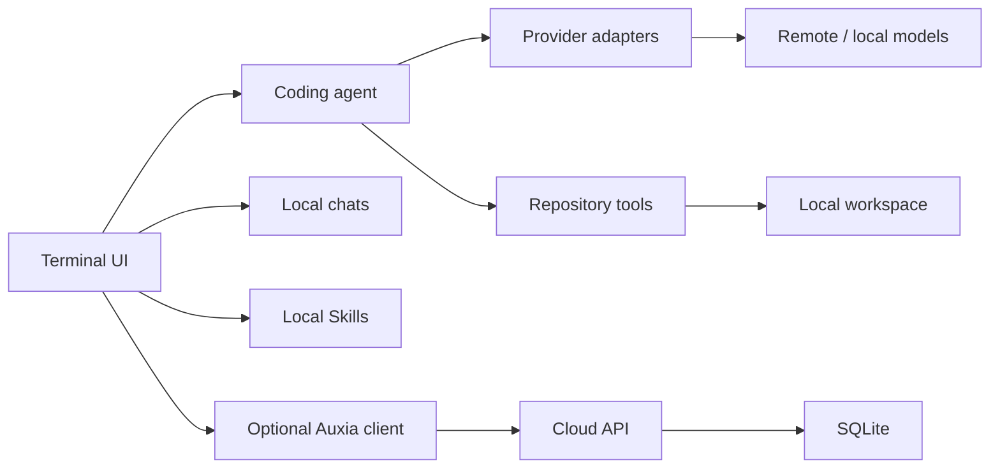

<div align="center">

# CodEz

### Your terminal. Your models. Your code.

A keyboard-first coding agent by **AuxiaCorp**.

[](LICENSE)
[](https://github.com/rollzian/CodEz/actions/workflows/ci.yml)
[](https://github.com/rollzian/CodEz/releases)
[](#the-interface)

[Capabilities](#capabilities) · [Interface](#the-interface) · [Architecture](#architecture) · [Cloud](#auxia-cloud) · [Studio Bridge](#codez-studio-bridge) · [License](#license)

</div>

---

> [!IMPORTANT]
> **Proprietary software. Public source viewing only.**
> Copyright © 2026 AuxiaCorp. All rights reserved. No new permission to install, run, modify, redistribute or commercialize CodEz is granted to the public. Separate written authorization is required, subject to applicable law, GitHub's terms and previously granted licenses.

## Project overview

CodEz combines local repository tools, model discovery, streaming responses, persistent conversations and optional team collaboration in one terminal application.

| Current published build | Language | Interface |
| :--- | :--- | :--- |
| **0.7.7 / #1h-1** | Go | Linux TUI |

This published build is a release candidate. The repository is available for inspection; releases published under the previous MIT license retain their original terms.

## CodEz Studio Bridge

[](https://github.com/rollzian/CodEz/tree/studio-bridge)

An independent local MCP module for CodEz Studio and compatible hosts.

| Integration | Capabilities |
| :--- | :--- |
| Browser | 19 Playwright tools |
| DaVinci Resolve | 26 scripting tools |
| Computer Use | 9 desktop tools; X11, Win32 and Wayland adapters |
| MCP | Stdio, Streamable HTTP, resources, prompts and registered-client OAuth |
| Vision | Image-based desktop interaction with local permission checks |

[**Explore Bridge source and documentation**](https://github.com/rollzian/CodEz/tree/studio-bridge)

Bridge 0.2.0 is a separate release candidate. Its previous test run passed 33 of 35 tests (2 skipped), including live X11 interaction and Chromium DOM checks. Windows, Wayland, live Resolve and external Vision API integrations still require validation. The Bridge is not bundled into the current CLI release, and the Studio GUI is not included.

The dedicated branch is temporary source hosting until a separate Studio repository is available. Do not merge its standalone tree into `main`.

## Capabilities

| Code | Navigate | Collaborate |
| :--- | :--- | :--- |
| Read, search and edit repositories | Keyboard-first model selection | Personal and team workspaces |
| Stream AI responses | Independent local conversations | Seven server-enforced roles |
| Run approved shell commands | Command palette and history | Invitations and friend requests |
| Review Git changes | Local Skills library | Public project directory |

## The interface

```text
  CODEZ                              workspace / main

  Model       Selected provider model
  Mode        Code

  › What would you like to build?

  ← Chats   Ctrl+K Menu   Ctrl+P Models   Shift+Tab Mode
```

*Illustrative layout, not a captured screenshot.*

### Choose your model

CodEz supports OpenAI Responses, Anthropic Messages and OpenAI-compatible chat APIs. Use a remote provider or a local server such as Ollama or LM Studio. The model catalog supports search and keyboard selection; pricing and ranking data depend on the provider.

### Choose your mode

| Mode | Access |
| :--- | :--- |
| Code | Repository tools and approved mutations |
| Ask | Read-only tools |
| Plan | Read-only tools |
| Review | Read-only tools |

## Keyboard shortcuts

| Keys | Action | Keys | Action |
| :--- | :--- | :--- | :--- |
| ← / → | Chats / return | Ctrl+K | Command palette |
| Ctrl+← | Workspaces | Ctrl+N | New chat |
| Ctrl+→ | Teams | Ctrl+P | Models |
| Ctrl+↑ | Friends | Ctrl+H | Prompt history |
| Ctrl+↓ | Public projects | Ctrl+F | Search chats |
| Ctrl+S | Save | Ctrl+L | Clear |
| Ctrl+R | Recall prompt | Shift+Tab | Switch mode |

Arrow keys edit nonempty input. Some shortcuts depend on terminal support. Use `CODEZ_SIMPLE_UI=1` for numbered menus and line input.

## Architecture



The CLI remains usable without an Auxia account. Cloud sessions and provider credentials are separate.

## Usage and security

<details>
<summary>Provider authentication, model discovery and terminal settings</summary>

Configure a provider and model on first launch. OpenAI and OpenRouter offer account sign-in or API-key authentication. ChatGPT sign-in opens the default browser when available and prints the official authorization URL as a fallback; approval returns through a loopback callback. Use the browser on the same machine. It uses an eligible ChatGPT plan, not a free API entitlement. OpenRouter sign-in prints a PKCE authorization URL and accepts the one-time code. Claude Console sign-in is a browser link for creating an API key; Claude subscription OAuth is not implemented. Custom providers require an OpenAI-compatible base URL and API key (empty for unauthenticated local servers). ChatGPT credentials are stored separately in an owner-only file, with refresh before requests. Live account authorization has not been verified; OAuth protocol tests use deterministic local fixtures. Supported protocols: OpenAI Responses, Anthropic Messages and OpenAI-compatible Chat Completions (including local endpoints). The model library discovers available models and uses arrow keys, Enter, search (/), filters (Tab), pagination (left/right), and Escape. OpenRouter supplies actual price and benchmark ordering; other providers expose only their available metadata. `/models [filter]` and `/model` open the library; `/model <id>` remains an explicit command. HTTP 401 triggers a forced ChatGPT token refresh when possible; rejected API keys require reconfiguration. Model discovery is checked before saving setup; `/setup` reconfigures; `/resume` loads recent history; `/new` creates an independent chat. `/status` shows the current model and session; `/clear` redraws the terminal.

Set `CODEZ_SIMPLE_UI=1` for numbered line-based selection. The terminal uses ANSI styling and live tool progress when attached to a TTY. Model responses stream via SSE by default; `CODEZ_NO_STREAM=1` selects non-streaming requests. `NO_COLOR=1` disables colors and animated progress; `CODEZ_NO_MOTION=1` disables animation only. Redirected output is free of ANSI formatting.

Repository tools: list, search, read, atomic write, exact text replacement, Git status/diff and shell execution. File mutations and shell execution require approval; shell commands run with the current user's OS permissions, not in a sandbox. Only known unsafe command patterns are additionally blocked. Credentials use a private `0600` file (not encrypted); `CODEZ_API_KEY` is accepted in noninteractive setup or by typing `:env` at the interactive key prompt. Saved credentials take priority on restart.

This is a release candidate, not a complete production-ready implementation. Live external provider credentials, MCP, automated deployment adapters, full context compaction and Arch installation are not verified or not implemented. Local tests cover SSE decoding for all three protocols; the smoke test exercises a deterministic HTTP provider and actual file changes, not a paid external API.

### Navigation and local chats

The interactive terminal clears on startup and shows the current Git branch when available. It restores the active local conversation (up to 80 recent events). `←` on empty input opens Chats; `→` returns from the list. `Ctrl+←/→/↑/↓` open Workspaces, Teams, Friends and Public Projects. `Ctrl+K` opens the palette, `Ctrl+N` creates a chat, `Ctrl+P` opens models, `Ctrl+H` on empty input opens prompt history, `Ctrl+F` searches chat titles, `Ctrl+S` flushes the current chat, `Ctrl+L` clears, `Ctrl+R` recalls a previous prompt, and `Shift+Tab` cycles modes. Arrow keys edit nonempty input. Bracketed paste preserves newlines in the submitted prompt; the editor displays a single horizontally scrolling line. `/chats` lists up to 500 recent chats in the current workspace. Drafts survive panel switches during the running process; they are not synced or persisted across restarts. `CODEZ_SIMPLE_UI=1` retains line input and numbered menus.

`/mode` offers Code, Ask, Plan and Review. Ask, Plan and Review advertise only read-only tools and reject model-requested mutations and shell commands. `/doctor` reports local config and Git availability. The system prompt reflects the selected provider model ID. `/skills` discovers `SKILL.md` in `.codez/skills/<name>/` and `$XDG_CONFIG_HOME/codez/skills/<name>/`, previews contents and asks before enabling them. Up to four local skills per process, each limited to 32 KiB; no script execution or remote installation.

</details>

## Auxia Cloud

`/menu` opens the command palette. `/auxia` opens the collaboration hub; `/workspaces`, `/teams`, `/friends`, and `/projects` open individual collections. `codez --auxia` is available without configuring an AI provider. Cloud sign-in opens an Auxia device-confirmation page in the browser. It does not send AI provider API keys to Auxia. The separate revocable Cloud session is stored in an owner-only file.

Personal and team workspaces are persistent metadata, not remote execution environments or synchronized source trees. Teams use explicit invitations and acceptance. Roles are Owner, Admin, Maintainer, Developer, Reviewer, Viewer and Guest. Only owners assign roles. Owner/Admin manage invitations and members; Admin cannot remove another Admin. Owner/Admin/Maintainer manage team workspace metadata; Developer creates and deletes their own team workspaces while a member. Reviewer/Viewer are read-only; Guest also cannot list members. Legacy members migrate to Developer. Friend requests require acceptance. Public projects publish a name and HTTPS repository link, not local files. Lists are limited to 200 items in this release.

The included `cloud/app.py` is an independently deployable service backed by SQLite. It must be mounted at `https://auxia.space/codez-cloud`; the domain's existing authentication backend and OAuth client registration were unavailable for live integration. No new Auxia password database is created. The service uses the existing identity provider's authorization-code + PKCE and authenticated userinfo endpoints. Register the callback `https://auxia.space/codez-cloud/oauth/callback` in that provider and configure the following server-only environment variables:

- `CODEZ_CLOUD_DB`: absolute path to a private database outside the public web root.
- `AUXIA_OAUTH_AUTHORIZE`, `AUXIA_OAUTH_TOKEN`, `AUXIA_OAUTH_USERINFO`: actual HTTPS endpoints from the Auxia identity provider. The authorization URL defaults to `https://auxia.space/api/login` as requested; confirm that it implements OAuth authorization-code + PKCE before deployment. Token and userinfo endpoints and client registration are required; this live contract was not verified.
- `AUXIA_OAUTH_CLIENT_ID`, `AUXIA_OAUTH_CLIENT_SECRET` (if required), `AUXIA_OAUTH_SCOPE` (default `openid profile`).

Local smoke: `python3 cloud/app.py` binds to `127.0.0.1:8088`. For public deployment, serve `cloud.app:create_app()` with a production WSGI server, behind the existing HTTPS reverse proxy at `/codez-cloud/`. Rate-limit anonymous device-start and login requests at the reverse proxy; do not log query strings or authorization headers. Use a restricted OS account and back up the SQLite database. The built-in WSGI server is for local testing only.

Verify with `python3 -m unittest discover -s cloud` and `go test ./...`. Local tests simulate the identity provider; live Auxia sign-in requires server deployment and a registered client.

## Authorized development

The following commands are for the rights holder and users with separate permission.

```bash
go vet ./...
go test ./...
go test -race ./...
CGO_ENABLED=0 go build -trimpath -o codez ./cmd/codez
python3 scripts/smoke.py ./codez
bash scripts/build-deb.sh
```

| Directory | Responsibility |
| :--- | :--- |
| [cmd/codez](cmd/codez) | Terminal UI and agent orchestration |
| [internal/provider](internal/provider) | Model discovery and API adapters |
| [internal/session](internal/session) | Local chat persistence |
| [internal/tools](internal/tools) | Repository and execution tools |
| [internal/skills](internal/skills) | Local skill discovery |
| [cloud](cloud) | Optional collaboration backend |
| [scripts](scripts) | Packaging and smoke tests |

## Project status

MCP execution, automated deployment adapters, full context compaction and production Auxia integration remain unfinished in the published build. Live provider authentication and native Arch installation have not been independently verified.

## License

**CodEz Proprietary Source-Viewing License**

| Public access | Permission under the new license |
| :--- | :--- |
| Read source and documentation on GitHub | Allowed |
| Install, execute or deploy | Written permission required |
| Modify or redistribute | Written permission required |
| Commercial or noncommercial reuse | Written permission required |

This table summarizes the new license, not the rights previously granted under MIT or GitHub's Terms of Service. GitHub permits users to view and fork public repositories through its service. The new license does not withdraw existing MIT permissions or change third-party licenses.

Read the complete [LICENSE](LICENSE) for the governing terms. Contact [the repository owner](https://github.com/rollzian) for permission requests.

---

<div align="center">

**CodEz / AuxiaCorp**

[Repository](https://github.com/rollzian/CodEz) · [Release history](https://github.com/rollzian/CodEz/releases) · [License](LICENSE)

Copyright © 2026 AuxiaCorp. All rights reserved.

</div>
